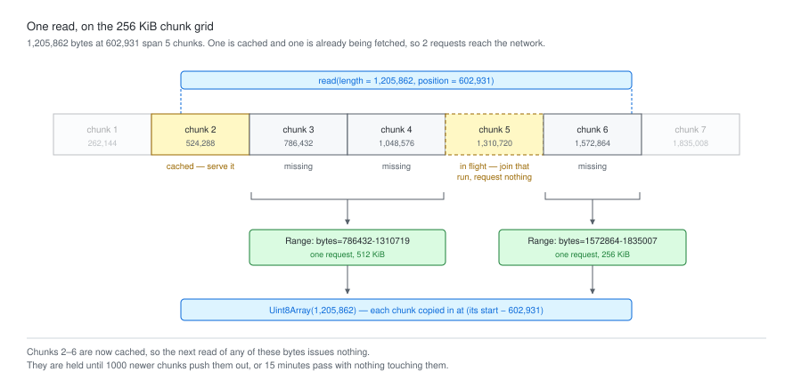

# @gmod/range-cache-filehandle

[](https://npmjs.org/package/@gmod/range-cache-filehandle)


A `GenericFilehandle` that caches byte ranges in chunks and coalesces adjacent
reads into one request.

An indexed genomics parser makes many small, adjacent, semi-random reads, most
near ones it just made. This layer sits under the parser, turns those reads into
a few large requests, and serves the next query's overlapping reads from memory.

```sh
npm install @gmod/range-cache-filehandle
```

## Usage

Drop-in for `RemoteFile` from
[generic-filehandle2](https://github.com/GMOD/generic-filehandle2):

```js
import { RemoteFileWithRangeCache } from '@gmod/range-cache-filehandle'
import { CramFile } from '@gmod/cram'

const cram = new CramFile({
  filehandle: new RemoteFileWithRangeCache('https://example.com/file.cram'),
})
```

`CachedFilehandle` wraps a local file or `Blob` instead. Its second argument
keys this file's chunks in the shared cache, so it must identify the underlying
bytes:

```js
import { CachedFilehandle } from '@gmod/range-cache-filehandle'
import { LocalFile } from 'generic-filehandle2'

const file = new CachedFilehandle(new LocalFile(path), `file://${path}`)
```

## Behavior



- Serves reads from a 256 KiB chunk grid. The chunks a read is missing are
  grouped into contiguous runs, one request each.
- Joins a chunk another read has in flight rather than requesting it again.
- Reference-counts each run's readers, so a shared request is cancelled only
  once all of them abort. A reader passing no signal pins it for everyone.
- Holds 1000 chunks (256 MB) per worker and sweeps chunks idle for 15 minutes.
  `clearCache()` drops everything, `clearCacheFor(key)` drops one file, and
  `sweepIdleCache()` reclaims early. `setChunkCacheLimit(bytes)` changes the cap
  and `cachedBytes()` reports what the cache holds.
- Runs 20 requests at a time **per origin**.
- Clamps reads past EOF once a size is known, from `Content-Range`, a 416, or
  `stat()`.
- Checks a `206` against its `Content-Range` and the range requested, so a
  truncated body or a proxy answering with the wrong range throws an error
  instead of being cached as a file that ends early.
- Names a cause on failure: CORS, mixed content, a server ignoring the Range
  header, a connection that goes 30s without answering.

The cache never retries a request and sets no time limit on a transfer, only on
the wait for a response to begin. To stop a read, abort the `AbortSignal` you
passed it; the cache passes the signal through to the socket.

[docs/dataflow.md](docs/dataflow.md) walks one read through all of it.

## Tuning

`CHUNK_SIZE`, `MAX_CACHE_ENTRIES`, `CACHE_IDLE_TIMEOUT_MS`, `MAX_CONCURRENT` and
`RESPONSE_TIMEOUT_MS` are exported for reading, not setting, because the cache
is module-global. [docs/tuning.md](docs/tuning.md) gives the measurements behind
each.

## Docs

- [docs/api.md](docs/api.md) — every export
- [docs/optimizations.md](docs/optimizations.md) — what cuts the request count
- [docs/dataflow.md](docs/dataflow.md) — how a read flows
- [docs/sharing.md](docs/sharing.md) — shared requests and aborts
- [docs/tuning.md](docs/tuning.md) — the constants and their measurements
- [docs/errors.md](docs/errors.md) — what each failure reports

## References

- [RFC 9110](https://www.rfc-editor.org/rfc/rfc9110.html) — HTTP semantics:
  [Range](https://www.rfc-editor.org/rfc/rfc9110.html#section-14.2) §14.2,
  [Content-Range](https://www.rfc-editor.org/rfc/rfc9110.html#section-14.4)
  §14.4, [206](https://www.rfc-editor.org/rfc/rfc9110.html#section-15.3.7)
  §15.3.7, [416](https://www.rfc-editor.org/rfc/rfc9110.html#section-15.5.17)
  §15.5.17
- [WHATWG DOM: dependent signals](https://dom.spec.whatwg.org/#abortsignal-dependent-signals)
  — why `AbortSignal.any` leaks nothing on a long-lived caller signal
- [whatwg/fetch#951](https://github.com/whatwg/fetch/issues/951) — why `fetch`
  has no timeout
- [Per-endpoint rate limiting](https://copdips.com/2023/01/python-aiohttp-rate-limit.html)
  — the pattern `MAX_CONCURRENT` uses

## The layer above

range-cache-filehandle caches bytes. Each parser that reads through it also
caches what it parsed, with a separate budget and idle timeout, and a hit in
that cache means the read never reaches this layer:

- [@gmod/bam](https://github.com/GMOD/bam-js) —
  [caching.md](https://github.com/GMOD/bam-js/blob/main/docs/caching.md)
- [@gmod/cram](https://github.com/GMOD/cram-js) —
  [memory.md](https://github.com/GMOD/cram-js/blob/main/docs/memory.md)
- [@gmod/tabix](https://github.com/GMOD/tabix-js) —
  [caching.md](https://github.com/GMOD/tabix-js/blob/main/docs/caching.md)
- [@gmod/bbi](https://github.com/GMOD/bbi-js) —
  [concurrency.md](https://github.com/GMOD/bbi-js/blob/main/docs/concurrency.md)

## Provenance

- Extracted from JBrowse 2, where it was
  `@jbrowse/core/util/io/RemoteFileWithRangeCache`, so parsers can use it
  without depending on `@jbrowse/core`.
- Replaces [http-range-fetcher](https://github.com/rbuels/http-range-fetcher),
  which merges the requests made in the last 100 ms. This package merges the
  chunks a read is missing, so it needs no window to wait out, and it passes an
  `AbortSignal` through to the socket.

## License

MIT
