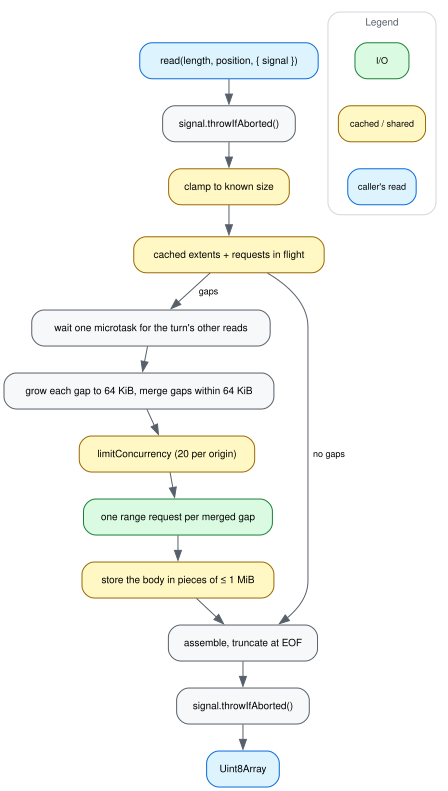

# How a read flows

[dataflow.dot](img/dataflow.dot) is the source; see
[CONTRIBUTING.md](../CONTRIBUTING.md) for how to re-render it.

A read arrives as `(length, position)`, such as a parser asking for the bytes of
a BAM index bin or a BGZF block. Per file, the cache holds the byte extents
earlier reads fetched and the requests still in flight. A read takes what those
cover and fetches only its gaps, so a query's many small, adjacent reads become
a few requests, and a second query over the same region makes none.

## Clamping

`getCachedRange` starts by cutting the requested range down to the file size,
when the size is known.

`@gmod/bam` and `@gmod/tabix` depend on clamping. They compute the end of their
last read as `maxv.blockPosition + (1 << 16)` so the final BGZF block is read
whole, which by construction runs past EOF on the last block of every file.
Unclamped, that tail would ask for bytes past the end of the file.

The size only ever shrinks. Each source is an upper bound on where the file
ends, and the cache keeps the smallest:

- the total in a `Content-Range` header;
- the start of a range that drew a 416;
- the end of a body shorter than its request, since a server supporting ranges
  clamps a range to the file;
- `stat()`, or a subclass calling `recordSize`.

The size cache is keyed like the extents rather than held on the filehandle, so
a new instance whose reads hit bytes an earlier instance fetched still has a
size to clamp against. A file that grew needs `clearCacheFor`.

A read that begins at or past the end returns empty without planning anything.

## Planning

A read whose range is wholly covered, by cached extents or by requests in
flight, is served at once: it holds the extents, joins the requests, and never
waits for a turn. [sharing.md](sharing.md) covers joining.

A read with gaps waits one microtask, so every read issued in the same turn
plans together: the reads a parser issues without awaiting between them land in
one turn. The flush runs with no `await` in it:

1. Each read's gaps are what neither the cache, a request in flight, nor an
   earlier read of this turn covers.
2. A gap shorter than `MIN_REQUEST` (64 KiB) grows forward to it, over uncovered
   bytes only and never past a known size. The growth is the readahead: a parser
   that just read a block usually reads the next one soon.
3. The turn's gaps are sorted, and any two within `MIN_REQUEST` of each other
   become one request, re-fetching the cached bytes between them if there are
   any. One round trip costs more than 64 KiB on any link worth designing for.

## Fetching

Each request goes through `limitConcurrency`, which allows at most 20 requests
in flight for any one origin and queues the rest, and then to the underlying
source. That step is the only part of this package that depends on the kind of
source. `RemoteFileWithRangeCache` sets a range header and calls `fetch`;
`CachedFilehandle` calls `read` on whatever it wraps.

When the body lands, the cache stores the parts no other request stored first,
in pieces of at most `PIECE_SIZE` (1 MiB), each a copy rather than a view. A
view would keep the whole body alive for as long as any one piece stayed cached,
so evicting it would free nothing. Pieces sit on one LRU list across every file,
and the cache evicts from its old end whenever it holds more than `CACHE_LIMIT`.

## Assembling

The read copies every extent and body it planned from into the result buffer at
offsets computed from absolute file positions. It takes references to the
extents before its first `await`, so a concurrent read's eviction cannot affect
it. A body shorter than its request marks the end of the file, and the result
stops there.

A read whose one request covers exactly its range, and which no other read
joined, gets that body itself with no copy.

A read waits for its requests and its own signal at once. Cancellation is per
reader even though the fetch is shared, so a reader that aborts rejects at once
with its own reason, while the request continues for the other readers.

## Where the two entry points differ

`RemoteFileWithRangeCache` overrides `fetchBytes`, which `RemoteFile.read` calls
after validating its arguments. The default `fetchBytes` builds a range header,
calls `fetch`, and unwraps a `Response`, which copies the whole range three
times, and on a cache hit no network time hides the cost of those copies. With a
warm cache, that round trip took 69-77% of the read (6.15ms vs 1.90ms at 16MB).

The `fetch` override also caches, so a caller that sets its own range header
reaches the same cache one layer lower. The override passes a `Request` object
straight through, because a `Request` has no stable cache key: `String(request)`
is `[object Request]` for every request there is.

Whole-file `readFile` skips the cache in both classes. The read is one pass over
bytes the caller is about to hold in full anyway, so caching it would double
peak memory with no reuse.

## Retries and progress

The cache retries nothing, so a failed range read becomes an error and the
reader decides what to do; see [errors.md](errors.md).

The cache reports no per-byte progress, because range reads return a fully
assembled in-memory `Response`. `generic-filehandle2`'s streaming `onProgress`
therefore receives the whole buffer at once and reports 0→100 instantly. The
indexed parsers report their own progress at block granularity from their index
metadata, which is the meaningful unit and also counts cache hits.
