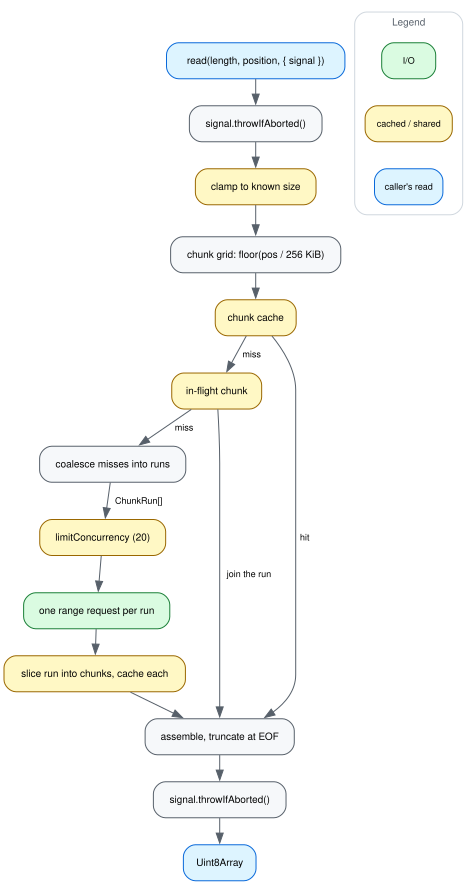

# How a read flows

[dataflow.dot](img/dataflow.dot) is the source; see
[CONTRIBUTING.md](../CONTRIBUTING.md) for how to re-render it.

A read arrives as `(length, position)`, such as a parser asking for the bytes of
a BAM index bin or a BGZF block. The cache rounds the range out to a 256 KiB
grid and resolves each chunk of the grid separately, and it requests only the
chunks that no earlier read has fetched or is fetching. A query's many small,
adjacent, semi-random reads therefore become a few large requests, and a second
query over the same region makes none.

The cache does this in four steps, in order: clamping, planning, fetching and
assembling.

## Clamping

`getCachedRange` starts by cutting the requested range down to the file size,
when the size is known.

`@gmod/bam` and `@gmod/tabix` depend on clamping. They compute the end of their
last read as `maxv.blockPosition + (1 << 16)` so the final BGZF block is read
whole, which by construction runs past EOF on the last block of every file.
Unclamped, that tail asks for chunks that start past the end of the file, and
the server answers 416.

The size cache takes the size from whichever of three sources answers first: a
`Content-Range` header on a 206, a `Content-Range` on a 416, or a `stat()`. The
size cache is keyed like the chunk cache rather than held on the filehandle,
because otherwise a new instance whose reads hit chunks an earlier instance
fetched would have no size to clamp against. `CachedFilehandle.stat()` records
the size it gets from the local file or Blob for the same reason.

A read that begins at or past the end has nothing left after the cut, and
returns empty without planning anything. The code checks for this case
explicitly, because the clamp moves the end and leaves the start where it was.
When the file size is not on a chunk boundary, a start past the end can fall in
the file's last chunk, the same chunk as the clamped end, and planning would
fetch that chunk to copy none of it.

When no size is known at all, as with a cross-origin server that does not expose
`Content-Range`, planning stops at a cached chunk shorter than 256 KiB, because
a short chunk marks where the file ended.

## Planning

Planning sorts each chunk index in the range into one of three cases. It runs as
a single synchronous pass with no `await` in it, so two reads arriving in the
same tick cannot both open a request for the same chunk.

- **Cached.** Serve the bytes, and move the entry to the end of the map's
  iteration order. Eviction takes from the front, so the move makes the cache an
  LRU rather than a FIFO by first fetch.
- **In flight.** Await the promise another read already has for it, and register
  this reader's interest in the run that promise belongs to.
  [sharing.md](sharing.md) describes that mechanism.
- **Missing.** Extend the current run of contiguous missing chunks, or open a
  new one.

The cache fetches each run with one range request covering every chunk in the
run. A single 4 kb viewport over a 2000x BAM came to 6.5 MiB in one request this
way.

## Fetching

Each run goes through `limitConcurrency`, which allows at most 20 requests in
flight for any one origin and queues the rest, and then to the underlying
source. That step is the only part of this package that depends on the kind of
source. `RemoteFileWithRangeCache` sets a range header and calls `fetch`;
`CachedFilehandle` calls `read` on whatever it wraps.

The cache slices the response into chunk-sized pieces with `slice`, not
`subarray`. A view would keep the whole 6.5 MiB run buffer alive for as long as
any one of its chunks stayed cached, so evicting a chunk would free nothing and
`MAX_CACHE_ENTRIES` would bound nothing. Because each chunk is a copy, the entry
count bounds memory. A run that crossed EOF comes back short, and the cache
stores the short chunk as-is so a later read finds the EOF marker instead of
asking again.

## Assembling

The read copies every chunk it uses into the result buffer at an offset computed
from absolute file positions, so a short chunk cannot shift the position of
later chunks. The read takes references to those chunks before its first
`await`, so eviction cannot affect it. The global cache is shared and capped, so
a concurrent read's `putCached` can drop a chunk this read still needs, but this
read still holds the chunk through its own reference.

A read waits for its chunks and its own signal at once. Cancellation is per
reader even though the fetch is shared, so a reader that aborts rejects at once
with its own reason, while the request continues for the other readers.

## Where the two entry points differ

`RemoteFileWithRangeCache` overrides `fetchBytes`, which `RemoteFile.read` calls
after validating its arguments. The default `fetchBytes` builds a range header,
calls `fetch`, and unwraps a `Response`, which copies the whole range three
times, and on a cache hit no network time hides the cost of those copies. With a
warm cache, that round trip took 69-77% of the read (6.15ms vs 1.90ms at 16MB).

The `fetch` override also caches, so a caller that sets its own range header
reaches the same cache one layer lower. The override passes a `Request` object
straight through, because a `Request` has no stable cache key: `String(request)`
is `[object Request]` for every request there is.

Whole-file `readFile` skips the cache in both classes. The read is one pass over
bytes the caller is about to hold in full anyway, so chunking it would double
peak memory with no reuse.

## Retries and progress

The cache retries nothing, so a failed range read becomes an error and the
reader decides what to do. [errors.md](errors.md) covers what the error reports
and how the reader decides.

The cache reports no per-byte progress, because range reads return a fully
assembled in-memory `Response`. `generic-filehandle2`'s streaming `onProgress`
therefore receives the whole buffer at once and reports 0→100 instantly. The
indexed parsers report their own progress at block granularity from their index
metadata, which is the meaningful unit and also counts cache hits.
